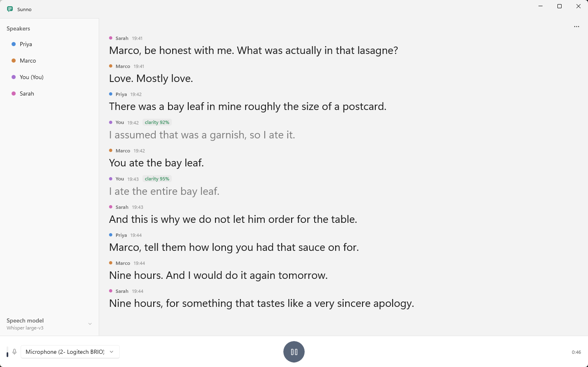
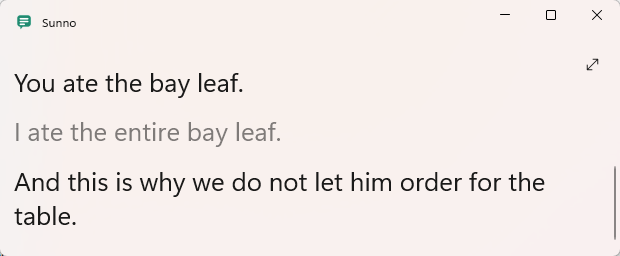
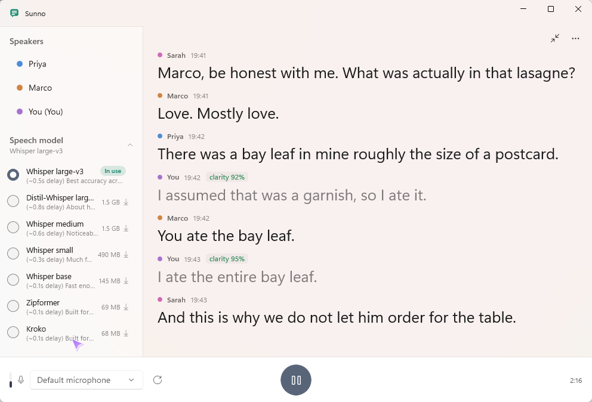

# Sunno

**Live captions for the conversation in front of you, running entirely on your own PC.**



---

## Why this exists

I kept missing things.

Not the big things. I hear those. It is the small ones that go past: the end of a sentence when
someone turns their head, the name of the restaurant, the punchline everyone else laughs at. You
nod along and hope nobody asks a follow up question. If you have done that, you already know why
this app exists.

Sunno means "listen" in Hindi and Urdu.

## What it does

### Engine preview in 1.0.84

The model picker now includes Moonshine Tiny, Small and Medium Streaming for English,
plus Windows AI Speech where Windows reports support. These are opt-in experiments:
no speed or accuracy ranking has been assigned yet, and your existing model choice stays
unchanged. Windows manages its speech model download. Unsupported native engines are
disabled with an explanation, not silently replaced by a cloud recognizer.

Live audio is conditioned once as it arrives. Streaming engines keep decoder state and
receive only new samples, including any samples accumulated while a caption refresh was
skipped. Whisper still receives complete utterances for its existing two-pass decoding.
Slow decoders get fewer provisional refreshes. Pause, device changes and helper failures
reset stream state so old text cannot leak into a new capture session.

Moonshine and the native engine currently provide line-level captions, without Whisper's
word confidence, clarity scores or word-level recording navigation. Native engines do not
use Sunno's custom vocabulary hints. Recognition remains local after model setup.

This is still an x64 Windows app, including on Snapdragon. The Windows AI helper is also
shipped as ARM64 and selected on ARM hardware; the rest of the app has not been made
ARM-native. The first observational benchmarks are recorded in
[bench/results](bench/results/README.md#2026-10-05-engine-preview-first-observational-pass).
They cover an i9-14900K desktop and M1 Max, not the older Intel or Snapdragon laptops.
The new engines remain opt-in; these limited measurements do not establish accent accuracy.

The expanded model picker is capped at three quarters of the sidebar, supports mouse-wheel
scrolling and shows the native slim scrollbar on hover. Unknown caption delays are labelled
explicitly. Windows model setup preserves the OS error and rechecks readiness after a
background installation, rather than caching an unavailable model until Sunno restarts.

### Appearance

Choose **System**, **Light** or **Dark** in Settings > Appearance.
System is the default and follows your Windows app appearance, including changes
made while Sunno is open. The choice is saved, and switching applies immediately
without restarting capture or reloading the speech model. Caption status colors
adapt to the selected appearance. Windows contrast themes take precedence.

### Everyday use

In **Settings > Updates**, choose **Check for updates** to look for newer stable releases
on GitHub. **Download update** shows progress and supports cancellation. **Install update**
opens Windows App Installer to complete the update. Settings and downloaded speech models
stay in place. Finish any recording first; updating closes Sunno and clears the live transcript.
Checks happen only when requested. No installer published on GitHub means there is no update
available through this button, even when newer source code or a local build exists.

Point it at a microphone and it writes down what people are saying, as they say it. Put it near
the table at dinner, beside you in a meeting, or pass a small mic to whoever is talking.

- **Fast enough to follow a conversation.** Around a third of a second behind on a machine with
  an NVIDIA GPU, so you are reading along rather than reading a transcript of something that
  already ended.
- **Optional speaker labels.** Choose Automatic (Experimental) to show revisable speaker
  labels, or Off for just the words. Naming people is optional.
- **Captions your PC's audio too,** which covers video calls, YouTube, podcasts, anything coming
  out of your speakers.
- **Handles accented speech well.** This was the whole reason for choosing Whisper large-v3 over
  faster alternatives. See [the engineering notes](docs/ENGINEERING.md#why-these-choices).
- **Shrinks to a strip** when you only want the words, and stays on top of whatever you are
  reading.
- **Runs without a graphics card.** Alongside the Whisper models there are two streaming ones,
  Zipformer and Kroko, built for machines with no GPU. Both are under 70 MB and stay about a
  tenth of a second behind.
- **Saves a conversation when you want one.** Press record and Sunno writes the audio and its
  transcript to your PC when you stop, with speaker labels and timestamps. Nothing is recorded
  unless you ask, the folder is not even created until the first save, and nothing is uploaded
  either way. See [Recording](#recording).
- Adjustable text size, always on top, and you can select and copy any part of the transcript.

Scroll up to read earlier captions without being pulled back down by new words. Scroll back
near the bottom, or select **Skip to current**, to resume following live captions. The subtle
floating button appears while you are reading above the latest captions. Finalizing text and
pauses in speech preserve your choice. Clearing the transcript also resumes following.

<table>
<tr>
<td width="50%"></td>
<td width="50%"></td>
</tr>
<tr>
<td>Compact mode, for when you want the words and nothing else.</td>
<td>Pick a model. Each one shows its size and how far behind it will run on your PC.</td>
</tr>
</table>

## It runs on your PC. All of it.

This matters more than any feature.

Captioning apps usually stream your microphone to a company's servers. That means the
conversation at your dinner table, with your family in it, leaves your house. People who have not
thought about it will still feel it, and they are right to.

Sunno does the recognition on your own machine. No account, no sign in, no telemetry, no server
to send anything to. Once setup is done, turn off your Wi-Fi and it works exactly the same. The
people around you are not being uploaded anywhere, and you can tell them so honestly.

Sunno downloads speech models and, on a PC with an NVIDIA graphics card, the CUDA libraries
that card needs. It also contacts GitHub when you request an app update check or download.
Captioning works offline, and updates never send your audio or captions.

Two things get written to disk, and both are yours: a pinned speaker's name and voice
fingerprint, so Sunno recognises them next time, and any recording you deliberately make. Full
details in [PRIVACY.md](PRIVACY.md).

## Recording

Press the record button beside the compact-mode button. Sunno writes the audio and its
transcript when you stop.

```
~/Sunno/Recordings/Recording/
  audio.m4a         AAC, 16 kHz mono, about 23 MB an hour
  transcript.json   speakers, timings, per word offsets
  transcript.txt    plain text with speaker labels and timestamps
```

Change the folder in Settings. A few things worth knowing:

- **Nothing is written until you press record.** The folder is not created until the first save,
  so an install that never records leaves no trace.
- **A recording ends when you stop it or close Sunno, and not before.** Pausing, swapping
  microphone, changing speech model and a dropped USB cable are all gaps inside one recording
  rather than the end of it.
- **An interrupted recording is finished on the next launch** rather than lost. Audio is appended
  as it arrives and each line is written as it is decoded, so a process that dies mid meeting
  costs you the sentence being spoken and nothing more.
- **The audio is the recogniser's own 16 kHz mono stream**, tapped before any conditioning. Right
  for speech and not archival, but it does mean the audio and the transcript can never disagree,
  because they are the same samples.

## Install

**Option A:**

<a href="https://get.microsoft.com/installer/download/9msv0v6jv8hk?referrer=appbadge&amp;cid=sunno-github"><picture><source media="(prefers-color-scheme: dark)" srcset="https://get.microsoft.com/images/en-us%20light.svg" width="200"></picture></a>

**Option B: From source** - see [Building](#building) below.

On first run Sunno downloads a speech model. Whisper large-v3 is roughly 3 GB; the streaming
models are under 70 MB. On a PC with an NVIDIA graphics card it also fetches about 450 MB of
CUDA libraries, once, alongside the model. Those used to ship inside the installer, which
made it 828 MB larger for every PC including the ones that can never use them. Downloading
models and checking for app updates need an internet connection; captioning does not.

It runs on any modern PC: with an NVIDIA GPU captions appear almost
immediately once those libraries are in place, and without one you can either use your
processor with a Whisper model, which works
but lags further behind, or pick one of the streaming models built for exactly that case.
The app measures your machine and tells you what to expect before you commit to a download.

**Looking for Sunno on a Mac?** It is a separate app, in
[desigrit/sunno-macos](https://github.com/desigrit/sunno-macos), with its own download.

## Building

Requires .NET 8, the Windows App SDK, and Python 3.12 from python.org. Not the Microsoft Store
Python build, which is sandboxed and unreliable at loading native CUDA DLLs.

```powershell
winget install --id Python.Python.3.12 --scope user
& "$env:LOCALAPPDATA\Programs\Python\Python312\python.exe" -m venv .venv
.\.venv\Scripts\python.exe -m pip install -r requirements.txt
```

Run the backend on its own, useful for testing without the desktop app:

```powershell
.\.venv\Scripts\python.exe -m server.app --list-devices
.\.venv\Scripts\python.exe -m server.app --device "Umik-1"
```

Build the installable package:

```powershell
.\packaging\build-msix.ps1
```

Tests are standalone scripts rather than pytest:

```powershell
.\.venv\Scripts\python.exe tests\test_biquad.py
.\.venv\Scripts\python.exe tests\test_hallucinations.py
```

## Honest about what it cannot do

No captioning system is perfect, and anyone who tells you otherwise is selling something.

- **Microphone placement matters more than the model.** Moving from a distant tabletop mic to a
  close talking one is worth roughly twice the accuracy, which is more than any model change
  available. There is a table of measured numbers in
  [the engineering notes](docs/ENGINEERING.md#microphone-matters-more-than-the-model).
- **Speaker labels are experimental.** Choose Off or Automatic in Settings under Captions.
  Automatic shows provisional labels alongside the words and can correct them as more speech
  arrives, without confirmation prompts or delaying transcription. Short turns, similar voices,
  and overlapping speech can still be mislabelled. Off stops scheduling speaker inference and
  ignores any result still finishing in the background. New installations
  start with Off; updates preserve the previous Automatic behavior until you change it.
  Voice references are learned in memory during the session. Naming or saving people is optional.
- **Overlapping speech degrades badly.** When two people talk at once, single channel
  recognition of any kind struggles. Separation models fast enough for real time are not
  practical yet on this hardware.
- **Across a noisy room it will drop words.**

It is a tool for catching more of what is said, not a court transcript. Used that way, it is
genuinely useful.

## How it fits together

```
microphone ──► resample 16 kHz ──► Silero VAD ──► Whisper large-v3 ──► WebSocket ──► WinUI app
                                                   (CUDA, or CPU)
```

A Python backend does capture and recognition. A WinUI 3 desktop app displays the results and
talks to it over a local WebSocket. They are separate processes on purpose, so the display could
later move to a handheld screen while this PC keeps doing the work.

| Directory | Contents |
|---|---|
| `server/` | Python backend: capture, VAD, recognition, speaker labelling |
| `app/` | WinUI 3 desktop app |
| `ui/` | Browser client, for the phone or handheld route |
| `packaging/` | Icon generation, CUDA trimming, MSIX build |
| `docs/CONTEXT.md` | Project context and accumulated learnings, for picking this up cold |
| `docs/ENGINEERING.md` | Why each decision was made, with the measurements behind it |

## Licence

MIT. See [LICENSE](LICENSE) and [THIRD-PARTY-NOTICES.md](THIRD-PARTY-NOTICES.md).

Sunno is free, and the source is public so you can read exactly what it does with your
microphone rather than taking my word for it. If you find something that contradicts
[PRIVACY.md](PRIVACY.md), that is a bug and I want to know about it.
